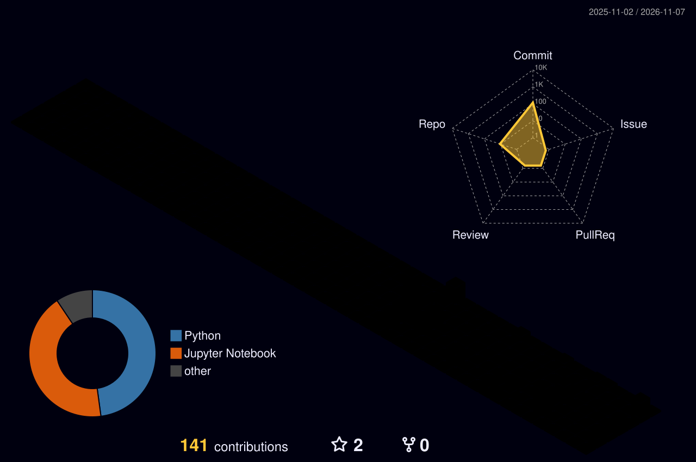
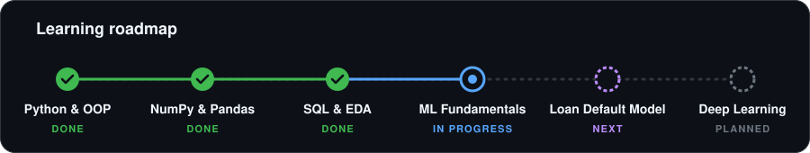

 

 

 

## 🔍 Featured Analysis

I like questions with a real answer in the data. In my [Loan Default Risk Analysis](https://github.com/Nayan-2006-opensource/Loan-Default-Risk-Analysis), I cleaned 25,000 loan applications, validated them with business-rule checks, and found which signals separate borrowers who repay from those who default.

 

## 🧰 Toolkit

 

| | |
|---|---|
| **Languages** | Python · SQL · C · Embedded C |
| **Data & ML** | Pandas · NumPy · Matplotlib · Seaborn · EDA · Feature Engineering · scikit-learn *(learning)* |
| **Tools** | Jupyter · Git & GitHub · MySQL · Tableau · Excel · VS Code |

 

## 💻 Right Now

## 🏙️ Contribution Skyline

## 🗺️ Roadmap

 

## 📂 Projects

<table>
<tr>
<td width="50%" valign="top">

### 🏦 [Loan Default Risk Analysis](https://github.com/Nayan-2006-opensource/Loan-Default-Risk-Analysis)
**Problem:** which applicants are likely to default?
**Result:** credit score is the strongest signal. 42.6% default below CIBIL 500 vs 0% above 770.

`Python` `Pandas` `NumPy` `Seaborn`

</td>
<td width="50%" valign="top">

### 🎓 [Student Marks Analyzer](https://github.com/Nayan-2006-opensource/Student-Marks-Analyzer)
**Problem:** analyse 15 students × 5 subjects without loops.
**Result:** totals, percentages, ranks, pass/fail and top/bottom 3 via vectorized NumPy.

`Python` `NumPy`

</td>
</tr>
<tr>
<td width="50%" valign="top">

### 🏧 [ATM Machine Simulation](https://github.com/Nayan-2006-opensource/ATM-Machine)
**Problem:** model a bank account safely.
**Result:** menu-driven ATM with PIN, deposit, withdrawal and balance, using encapsulated OOP.

`Python` `OOP`

</td>
<td width="50%" valign="top">

### ➗ Fraction & Matrix Classes
**Problem:** build math types from scratch.
**Result:** Fraction and 2×2 Matrix with operator overloading, no NumPy or `fractions`.

`Python` `OOP`

</td>
</tr>
</table>

 

## 🏅 Certifications

| Certification | Issuer | Date |
|---|---|---|
| SQL (Intermediate) | HackerRank | Nov 2026 |
| SQL (Basic) | HackerRank | Oct 2026 |
| Data Analytics Job Simulation | Deloitte Australia (via Forage) | Sep 2026 |

 

## 📊 GitHub Activity

 
 

**Open to Data Science / AI-ML internships. Let's talk data.**

